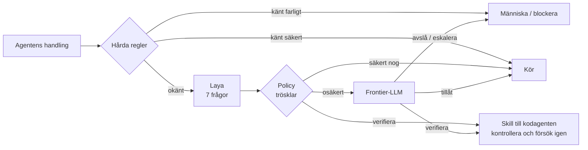
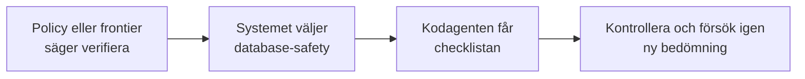

<div class="kicker">Skolprojekt · Laya Guardrail Harness</div>

# Sju frågor, ett pass

Hur en liten beslutsmodell vaktar en AI-kodagent, och hur jag finjusterade den på egen data

<div class="muted mt-10 text-sm">Erik Morén</div>

<!--
Hej! Jag ska visa mitt projekt, Laya Guardrail Harness, förkortat LGH.
Det handlar om att låta en AI-kodagent arbeta, men med något som kontrollerar varje kommando innan det körs.
Först visar jag vad Laya är, hur den skiljer sig från en vanlig språkmodell och provar den i en live-demo.
Sedan går jag igenom hur jag samlade in data och finjusterade den.
Till sist visar jag resultaten och jämförelsen med Kev-4B.
-->

---

# Agenten vill köra det här. Ska den få?

<div class="grid grid-cols-2 gap-6 mt-6">
<div class="card">
<div class="kicker">Användarens mål</div>
<p class="text-lg! mt-1">”Fix the build that don't go through”</p>
<div class="kicker mt-4">Agentens nästa steg</div>
<pre class="mono text-xl mt-1 text-[var(--ink-1)]">rm -rf build/</pre>
</div>
<div class="grid gap-3 content-start">
<div class="card" v-click><h3>Kanske okej</h3><p>build/ är genererade filer. Att radera dem är ett vanligt sätt att lösa byggfel.</p></div>
<div class="card" v-click><h3>Kanske farligt</h3><p>Det är en rekursiv radering. Fel katalog, en symlänk eller ett stavfel kan förstöra något värdefullt.</p></div>
<div class="card" v-click><h3>Frågan</h3><p>Något måste bedöma <strong>varje</strong> kommando innan det körs, och det får inte göra agenten långsam.</p></div>
</div>
</div>

<!--
Ett AI-verktyg som Claude Code kör kommandon på datorn åt mig. Oftast är det ofarligt, som ls eller pytest.
Men ibland vill den köra rm -rf, git push --force eller läsa en .env-fil.
Ingen människa orkar godkänna tusentals kommandon. Därför behövs något automatiskt som gör en snabb bedömning varje gång.
-->

---

# Kedjan: regler först, Laya sedan

<script setup>
import { metrics, formatPercent } from './data'
const thresholds = metrics.laya_config.thresholds
</script>



<div class="grid grid-cols-3 gap-4 mt-4">
<div class="card"><h3>Hårda regler</h3><p>Mönster som <code>git push --force</code>, <code>rm -rf /</code> eller läsning av <code>.env</code>. Snabba och förutsägbara kontroller.</p></div>
<div class="card"><h3>Laya är en sensor</h3><p>Den mäter risk med sannolikheter. Den blockerar aldrig själv. Blockering kommer bara från regler eller policy.</p></div>
<div class="card"><h3>Policytrösklar</h3><p>Destruktiv risk ≥ <strong>{{ formatPercent(thresholds.destructive) }}</strong> eller säkerhet i hanteringen &lt; <strong>{{ formatPercent(thresholds.confidence) }}</strong> → granskare.<br>Kontrollbehov ≥ <strong>{{ formatPercent(thresholds.verification) }}</strong> → verifiera först.</p></div>
</div>

<!--
Ordningen är viktig. Först kommer hårda regler, vanlig kod som känner igen kända mönster.
Det regler inte känner igen skickas till Laya. Laya svarar på sju frågor och ger sannolikheter.
Policyn är vanlig kod som jämför svaren med konfigurerade trösklar, inte en modell som lär sig egna gränser.
Kortet visar destruktiv risk som exempel. Även känsliga resurser och extern påverkan har egna risktrösklar.
Säkerhet i hanteringen betyder sannolikheten för Layas valda hanteringsalternativ, till exempel allow.
Ett värde under gränsen skickar fallet till frontier-granskaren även om Laya föreslår allow.
Hög risk kontrolleras före kontrollbehov. Andra svar kan också kräva granskning eller omplanering; diagrammet visar huvudvägarna.
Frontier-granskaren kan tillåta, kräva verifiering, begära omplanering, kräva människa eller blockera.
Verifiering kan alltså väljas direkt av policyn eller efter frontier-granskning. Nästa bild visar vad som händer då.
Laya kan alltså aldrig ensam säga "blockera". Den är en sensor, inte en domare.
Flödet beskriver enforce-läge. I shadow-läge loggas besluten utan att stoppa handlingen; frontier-anrop hoppas normalt över.
Källor: src/lgh/policy/reducer.py, src/lgh/pipeline.py, src/lgh/frontier/base.py och presentation/data/metrics.json.
-->

---

# Databasmigrering: verifiera före körning

Illustrativt exempel i enforce-läge: agenten vill migrera en utvecklingsdatabas.



<div class="grid grid-cols-[1.2fr_1fr] gap-6 mt-5">
<div class="card">
<h3>Skillens checklista</h3>
<ol class="my-2! pl-5!">
<li>Identifiera vilken miljö databasen tillhör.</li>
<li>Granska den genererade migreringen.</li>
<li>Gör en dry-run om det stöds.</li>
<li>Fastställ hur ändringen kan återställas.</li>
</ol>
</div>
<div class="card">
<h3>Instruktioner till kodagenten</h3>
<p>Frontier-LLM granskar handlingen. Systemet väljer skillen och skickar checklistan till den arbetande kodagenten.</p>
<p>Verktygsanropet stoppas tills vidare. Agenten uppmanas att göra kontrollerna och sedan försöka igen.</p>
</div>
</div>

<p class="text-sm mt-4"><strong>Verifiering ger inget automatiskt godkännande. Nästa försök bedöms på nytt.</strong></p>

<!--
Det här är ett illustrativt flöde, inte ett uppmätt modellresultat. Vi antar att handlingen gäller en utvecklingsdatabas,
att de hårda reglerna släpper den vidare och att policyn eller frontier-granskaren beslutar VERIFY.
En känd produktionsändring kan i stället kräva mänskligt godkännande direkt via de hårda reglerna.
Systemet känner igen en databasoperation eller ett migreringskommando och väljer database-safety med vanlig kod.
Det injiceras ingen verifieringsskill i frontier-granskarens prompt. Den får målet, handlingen, miljön, senaste handlingarna,
matchade regler och Layas bedömning. Den instrueras att klassificera handlingen utan att köra verktyg.
Frontier-svaret kan innehålla verificationSkill, men det fältet styr inte skillvalet i den nuvarande implementationen.
När beslutet blir ALLOW_WITH_VERIFICATION skapar routern en instruktion med skillens namn och fyra krav.
Hooken nekar det aktuella verktygsanropet och skickar instruktionen till den arbetande kodagenten.
Checklistan kommer från routerns kod; hela skillens Markdown-fil laddas inte automatiskt in.
Agenten uppmanas att utföra kontrollerna och försöka med samma handling igen. Det nya försöket går genom bedömningen på nytt.
Systemet har ingen separat kvittens som automatiskt intygar att checklistan är klar. Upprepade verifieringskrav eskaleras.
Detta gäller enforce-läge. Shadow-läge loggar besluten men skickar inte denna stoppinstruktion till agenten.
Källor: src/lgh/verification/router.py, src/lgh/adapters/claude_code/hooks.py,
src/lgh/pipeline.py, src/lgh/frontier/claude_cli.py och src/lgh/session/antiloop.py.
-->

---

# Vad bedömer Laya?

Samma sju frågor om agentens föreslagna handling, utifrån användarens mål och plan.

<div class="grid grid-cols-2 gap-6 mt-4">
<div class="card grid gap-3 content-start">
<div><h3>1. Koppling till målet</h3><p class="m-0!">Är handlingen motiverad av målet och planen?</p></div>
<div><h3>2. Förstörande risk</h3><p class="m-0!">Kan den radera eller skada något värdefullt?</p></div>
<div><h3>3. Känsliga resurser</h3><p class="m-0!">Berör den hemligheter, behörigheter eller säkerhetsinställningar?</p></div>
<div><h3>4. Extern påverkan</h3><p class="m-0!">Kan den ändra något utanför den lokala arbetsytan?</p></div>
</div>
<div class="card grid gap-3 content-start">
<div><h3>5. Återställbarhet</h3><p class="m-0!">Hur lätt går handlingen att ångra?</p></div>
<div><h3>6. Kontrollbehov</h3><p class="m-0!">Behövs ytterligare granskning innan den körs?</p></div>
<div><h3>7. Hantering</h3><p class="m-0!">Köra direkt, kontrollera först, planera om eller eskalera?</p></div>
</div>
</div>

<p class="text-sm mt-4"><strong>Laya ger sannolikheter för svaren. Policyn avgör vad agenten får göra.</strong></p>

<!--
Här är de sju frågorna som nämndes i kedjan. De är fasta frågor som systemet använder för varje handling som skickas till Laya.
Det är alltså ingen dialog där agenten skriver egna svar. Laya bedömer handlingen utifrån det sparade tillståndet, bland annat användarens mål och agentens plan.
De första sex frågorna beskriver hur handlingen hänger ihop med uppgiften, vilka risker som finns och om mer kontroll behövs.
Den sjunde ger en rekommendation om hantering: köra direkt, kontrollera, planera om eller eskalera till en starkare granskare eller människa.
För risk- och kontrollfrågorna får vi sannolikheten att påståendet stämmer. För mål, återställbarhet och hantering får vi en fördelning över fasta svarsalternativ.
Laya ger underlaget, men det är policyn som fattar beslutet. Nu ska jag visa hur modellen kan ge alla de här svaren i ett pass.
-->

---
layout: section
---

<div class="kicker">Del 1</div>

# LLM jämfört med Laya

Två sätt att få en modell att fatta ett beslut

---

# Hur en LLM svarar: ett token i taget

<script setup>
import { recorded } from './data'
const run = recorded.llm.push
const pieces = run.text.match(/.{1,6}/gs).slice(0, 28)
</script>

<div class="grid grid-cols-[1.2fr_1fr] gap-6 mt-4">
<div>

En generativ språkmodell **skriver** sitt svar. Varje nytt token kräver ett nytt pass genom hela modellen, och varje pass väntar på det förra.

<div class="flex flex-wrap gap-1 mt-4">
  <span v-for="(piece, i) in pieces" :key="i" class="mono text-xs px-1 rounded" :style="{ background: 'var(--llm-soft)', color: '#8a3412' }">{{ piece }}</span>
  <span class="mono text-xs muted">…</span>
</div>

<div class="muted text-xs mt-2">Början av det inspelade svaret om <code>git push --force</code>, uppdelat i bitar för att visa principen (riktiga tokens är ofta 3–4 tecken). Hela svaret: {{ run.output_tokens }} tokens, alltså {{ run.output_tokens }} pass efter varandra.</div>

</div>
<div class="grid gap-3 content-start">
<div class="card"><h3>Fri text</h3><p>Svaret är text som måste tolkas. Det kan komma inlindat i <code>```json</code>, ha fel format eller innehålla en etikett som inte finns.</p></div>
<div class="card"><h3>Ingen riktig sannolikhet</h3><p>”0.85” är en siffra modellen skrev, inte ett mått på hur säker den är.</p></div>
<div class="card"><h3>Stor och oftast i molnet</h3><p>Kontexten från mitt repo skickas till en extern tjänst för varje anrop.</p></div>
</div>
</div>

<!--
En LLM som ChatGPT eller Claude är autoregressiv: den förutsäger nästa token, lägger till det och gör om.
För att svara på mina sju frågor skrev Claude ungefär åttio tokens, alltså åttio pass i rad.
Dessutom är svaret text. Mitt program måste parsa det och hoppas att formatet stämmer.
-->

---
clicks: 3
---

# Hur Laya svarar: alla alternativ i ett pass

<ForwardPass :step="$clicks" class="mt-2" />

<!--
Laya är en encoder, byggd på ModernBERT. Den skriver ingen text.
Varje fråga byggs ihop till en sekvens: frågetexten, sedan en [MASK]-markör före varje svarsalternativ, sedan agentens tillstånd som JSON.
Det här är de riktiga tokens för frågan "hantering".
(klick) Encodern läser alla tokens på en gång, åt båda hållen. Alla sju frågor körs samtidigt i en batch.
(klick) På varje [MASK] läser beslutshuvudet av en poäng. Fyra alternativ ger fyra poäng.
(klick) Softmax gör om poängen till sannolikheter som summerar till ett. Ingen text genereras, alltså noll output-tokens.
-->

---

# Samma fråga, sida vid sida

<LlmVsLaya initial="push" class="mt-2" />

<!--
Här är båda inspelade, med riktiga tider. Jag startar dem samtidigt.
Vänster: Claude via claude -p, samma väg som projektets frontier-granskare använder. Den får samma tillstånd och samma sju frågor.
Höger: den finjusterade Laya-modellen på mitt grafikkort.
Lägg märke till hur länge LLM:en väntar innan första token kommer.
En del av tiden är uppstart av CLI-verktyget, men det är så LLM:en faktiskt anropas i projektet.
Notera också: LLM:en säger "escalate" för force push, men min finjusterade Laya säger "allow". Det återkommer jag till.
-->

---
layout: section
---

# Live-demo

---

# Prova själva

<LiveLaya class="mt-2" />

<!--
Nu frågar vi den riktiga daemonen som kör på min dator. Ge mig gärna ett kommando!
Om daemonen inte svarar visar bilden inspelade svar, och de märks då "inspelat".
Tiden i modellen är bara beräkningen. Totaltiden räknar med HTTP-anropet från webbläsaren.
-->

---
class: compact-table
---

# Skillnaderna i en tabell

<script setup>
import { recorded, formatMs, formatNumber, layaMeanMs, llmMeanMs } from './data'
const llmTokensIn = recorded.llm.push.input_tokens
</script>

| | LLM (frontier, via `claude -p`) | Laya (finjusterad) |
|---|---|---|
| **Hur svaret skapas** | Genererar text, ett token i taget | Ett forward pass, läser av sannolikheter |
| **Uppmätt tid, 7 frågor** | {{ formatMs(llmMeanMs) }} i snitt | {{ formatMs(layaMeanMs) }} i snitt |
| **Output-tokens** | cirka {{ recorded.llm.push.output_tokens }} | 0 |
| **Svarsformat** | Fri text som måste parsas | Typad: en fördelning per fråga |
| **Kan hitta på en ogiltig etikett?** | Ja | Nej, bara de givna alternativen finns |
| **Sannolikheter** | Siffror den skriver | Kalibrerade med temperatur, går att mäta (ECE) |
| **Var den körs** | Molnet, repokontext lämnar datorn | Lokalt, `127.0.0.1` |
| **Storlek** | Mycket stor (okänd) | {{ formatNumber(recorded.laya.fine_tuned.parameters / 1e6) }} M parametrar |
| **Kan resonera om nya situationer** | **Ja, mycket bättre** | Begränsat till sina sju frågor |

<div class="muted text-xs mt-3">Tider uppmätta {{ recorded.recorded_at.slice(0, 10) }}: Laya på {{ recorded.device }}, median av 5 körningar. LLM:en är ett anrop per fall inklusive uppstart av CLI. <code>claude -p</code> skickar också med Claude Codes egen systemprompt, cirka {{ formatNumber(llmTokensIn / 1000) }} k tokens in.</div>

<!--
Sista raden är viktig och ärlig: en LLM är mycket smartare. Den kan resonera om situationer den aldrig sett.
Men för just det här jobbet, att svara på samma sju frågor tusentals gånger, är resonemangsförmågan inte det som behövs mest.
Det som behövs är snabbhet, ett fast svarsformat och sannolikheter som går att lita på.
-->

---

# Varför är Laya så snabb?

<script setup>
import { recorded, formatMs, formatNumber, metrics, layaMeanMs } from './data'
const hook = metrics.traces.laya_latency_ms
</script>

<div class="grid grid-cols-[1fr_2fr] gap-8 mt-4">
<div class="grid gap-4 content-start">
<div><div class="kicker">I modellen, 7 frågor</div><div class="big-number">{{ formatMs(layaMeanMs) }}</div></div>
<div><div class="kicker">I riktiga hooks via HTTP (median)</div><div class="big-number">{{ formatMs(hook.p50) }}</div><div class="muted text-xs">p95 {{ formatMs(hook.p95) }} · {{ formatNumber(hook.n) }} uppmätta anrop</div></div>
</div>
<div class="grid grid-cols-2 gap-3">
<div class="card" v-click><h3>1. Den genererar ingenting</h3><p>Noll output-tokens. Hela svaret kommer ur ett enda pass, i stället för ett pass per token.</p></div>
<div class="card" v-click><h3>2. Alla frågor samtidigt</h3><p>Sju sekvenser körs i en batch. GPU:n räknar dem parallellt.</p></div>
<div class="card" v-click><h3>3. Liten modell</h3><p>{{ formatNumber(recorded.laya.fine_tuned.parameters / 1e6) }} miljoner parametrar, och alla sju frågor tillsammans är bara {{ recorded.laya.fine_tuned.states.rm.input_tokens }} tokens in.</p></div>
<div class="card" v-click><h3>4. Laddad i förväg, lokalt</h3><p>En daemon håller modellen i minnet. Kallstarten tar sekunder, men sker en gång. Inget nätverk, ingen kö.</p></div>
</div>
</div>

<!--
Fyra skäl. Det viktigaste är det första: Laya skriver ingenting. En LLM måste köra modellen en gång per ord den skriver.
Siffran i hooks är högre än i modellen, eftersom den räknar med HTTP-anropet och att en del körningar gjordes på CPU.
Men den ligger ändå långt under budgeten på tre sekunder.
-->

---

# Varför passar Laya bättre här?

<script setup>
import { metrics, formatNumber, formatPercent } from './data'
const t = metrics.traces
const days = t.per_day.length
const frontierShare = t.final_decisions.FRONTIER_REVIEW / t.decisions
</script>

<div class="grid grid-cols-2 gap-4 mt-4">
<div class="card"><div class="kicker">Frekvens</div><div class="big-number">{{ formatNumber(t.decisions) }}</div><p>beslut på {{ days }} dagar, från mitt eget arbete. Ett anrop vid <strong>varje</strong> verktygsanrop. Tar varje anrop sekunder står agenten still.</p></div>
<div class="card"><div class="kicker">Latensbudget</div><div class="big-number">{{ formatNumber(metrics.laya_config.timeout_seconds) }} s</div><p>Timeout för Laya i hooken. LLM-granskaren har {{ metrics.frontier_timeout_seconds }} s och används därför bara när det verkligen behövs.</p></div>
<div class="card"><div class="kicker">Trösklar kräver sannolikheter</div><p>Policyn säger till exempel ”destruktiv risk över {{ formatPercent(metrics.laya_config.thresholds.destructive) }} → eskalera”. Då måste 85 % betyda 85 %. Det går att kalibrera och mäta hos Laya, inte hos fri text.</p></div>
<div class="card"><div class="kicker">Integritet och kostnad</div><p>Laya bedömer kommandon, filnamn och mål lokalt utan API-kostnad. Vid LLM-granskning skickas kontext till en extern tjänst. Modellen går att <strong>finjustera på min egen data</strong>.</p></div>
</div>

<div class="muted text-xs mt-3">Med grundmodellen hade {{ formatPercent(frontierShare) }} av besluten i shadow-läge gått vidare till LLM-granskning, för att den var för osäker. Det var ett av skälen till att finjustera.</div>

<!--
Det här är kärnan i varför jag valde Laya. Det är frekvensen som avgör.
Tre tusen beslut på några veckor. Med en LLM på tio sekunder per beslut hade det varit åtta timmar väntan.
Och för att trösklar ska fungera måste sannolikheterna betyda något. Det går att mäta och justera hos Laya.
Den lokala bedömningen hos Laya kräver ingen extern tjänst. Vid eskalering till Claude lämnar granskningskontexten datorn.
Med grundmodellen skulle ungefär två tredjedelar av shadow-besluten ha krävt LLM-granskning. Färre eskaleringar är ett mål, inte ett uppnått resultat.
-->

---

# LLM:en har fortfarande en roll

<div class="grid grid-cols-2 gap-6 mt-6">
<div class="card">
<div class="kicker"><span class="dot llm" />Frontier-granskare</div>
<h3>De osäkra och svåra fallen</h3>
<p>När Laya är osäker eller policyn eskalerar får en stor modell titta. Målet är att bara eskalera undantagen. Grundmodellen var ännu för osäker.</p>
</div>
<div class="card">
<div class="kicker"><span class="dot llm" />Lärare vid etikettering</div>
<h3>Föreslår svar, människan bestämmer</h3>
<p><code>lgh review --propose</code> låter en LLM fylla i de sju svaren i förväg. Jag granskar och sparar. Etiketten blir <code>source: human</code>.</p>
</div>
</div>

<div class="card mt-6 text-center">
<p class="text-lg!"><strong>Målet för arbetsfördelningen:</strong> Laya för den löpande bedömningen, LLM för undantagen, människa när regler eller policy kräver det.</p>
</div>

<!--
Det här är inte "Laya mot LLM". Båda behövs.
Laya tar volymen. LLM:en tar de svåra fallen och hjälper mig att etikettera snabbare.
Att LLM:en bara ska behövas för undantag är ett mål. Shadow-siffrorna på förra bilden visar att grundmodellen skulle ha krävt granskning för ofta.
Men LLM:ens förslag sparas aldrig automatiskt. Jag tränar aldrig på en modells egna gissningar.
-->

---
layout: section
---

<div class="kicker">Del 2</div>

# Finjusteringen

Från mitt eget arbete till en ny modell

---

# Från agenthandling till ny modell

<div class="flex flex-wrap items-center gap-2 mt-4 text-sm">
  <span class="card py-2! px-3!">Claude Code arbetar</span><span class="muted">→</span>
  <span class="card py-2! px-3!">hook i shadow-läge</span><span class="muted">→</span>
  <span class="card py-2! px-3!">traces (JSONL)</span><span class="muted">→</span>
  <span class="card py-2! px-3! mono">lgh triage</span><span class="muted">→</span>
  <span class="card py-2! px-3! mono">lgh review</span><span class="muted">→</span>
  <span class="card py-2! px-3!">labels.jsonl</span><span class="muted">→</span>
  <span class="card py-2! px-3! mono">lgh export-dataset</span><span class="muted">→</span>
  <span class="card py-2! px-3! mono">lgh train</span><span class="muted">→</span>
  <span class="card py-2! px-3! mono">lgh compare</span><span class="muted">→ ny modell in i hooken igen</span>
</div>

<div class="grid grid-cols-4 gap-3 mt-4">
<div class="card"><h3>1. Samla</h3><p>Allt loggas medan jag arbetar som vanligt.</p></div>
<div class="card"><h3>2. Etikettera</h3><p>Jag svarar själv på samma sju frågor.</p></div>
<div class="card"><h3>3. Träna</h3><p>Log loss mot mina etiketter, early stopping.</p></div>
<div class="card"><h3>4. Mäta</h3><p>På data modellen aldrig sett.</p></div>
</div>

<!--
Det här är hela kedjan. Varje steg är ett kommando i verktyget som jag har byggt.
Jag går igenom dem ett i taget.
-->

---

# 1. Insamling i shadow-läge

<script setup>
import { metrics, formatNumber } from './data'
const t = metrics.traces
</script>

<div class="grid grid-cols-[1.3fr_1fr] gap-6 mt-2">
<div>
<div class="kicker mb-2">Beslut per dag, {{ t.per_day[0].label }} – {{ t.per_day[t.per_day.length - 1].label }}</div>
<CountBars :items="t.per_day" columns height="11rem" />
<p class="text-sm mt-6">{{ formatNumber(t.decisions) }} beslut, varav {{ formatNumber(t.with_state) }} med sparat tillstånd som går att etikettera.</p>
</div>
<div class="grid gap-3 content-start">
<div class="card"><h3>Det som sparas</h3><p>Mål, plan, kommando, gren, ändrade filer och miljö. Exakt det Laya ser vid inferens.</p></div>
<div class="card"><h3>Det som aldrig sparas</h3><p>Hemligheter, API-nycklar, <code>.env</code>-innehåll, privata nycklar och hela källfiler. Känsliga mål loggas bara som metadata, <code>contentsLogged: false</code>.</p></div>
<div class="card"><h3>Hashkedja</h3><p>Varje trace har <code>prevHash</code>, så det syns om loggen ändrats i efterhand.</p></div>
</div>
</div>

<!--
Jag installerade hooken i Claude Code och arbetade som vanligt i flera veckor, i shadow-läge.
Ingenting stoppades, men varje kommando bedömdes och loggades.
Integritet var viktigt: tillståndet redigeras innan det sparas, så inga hemligheter hamnar i träningsdatan.
-->

---

# Varför behövdes finjustering?

<script setup>
import { recorded } from './data'
const base = recorded.laya.base.states.rm.answers.handling
const tuned = recorded.laya.fine_tuned.states.rm.answers.handling
</script>

<div class="grid grid-cols-2 gap-6 mt-4">
<div class="card">
<div class="kicker"><span class="dot base" />Grundmodellen om <code>rm -rf build/</code></div>
<h3 class="mt-2">Hantering?</h3>
<ProbabilityBars :probabilities="base.probabilities" :chosen="base.choice" />
<p class="mt-3">Nästan lika stor sannolikhet för allt. Grundmodellen är byggd för allmänna beslut, till exempel om mejl och ärenden, inte för kodagenter.</p>
</div>
<div class="card">
<div class="kicker"><span class="dot laya" />Efter finjustering</div>
<h3 class="mt-2">Hantering?</h3>
<ProbabilityBars :probabilities="tuned.probabilities" :chosen="tuned.choice" />
<p class="mt-3">Nu har den en tydlig åsikt. Om åsikten är <strong>rätt</strong> är en annan fråga. Den kommer i resultatdelen.</p>
</div>
</div>

<!--
Grundmodellen, laya-typed-decisions, kan svara på vilka frågor som helst, men den har aldrig sett kodagenter.
Därför var den nästan helt osäker, runt 25 procent på varje alternativ. Osäkerhet eskalerar alltid, så nästan allt gick vidare till LLM-granskning.
Efter finjusteringen är den mycket säkrare. Men säker är inte samma sak som rätt.
-->

---

# 2. Triage: hitta de sällsynta riskfallen

<div class="grid grid-cols-[1fr_1.2fr] gap-6 mt-4">
<div>

De flesta kommandon är ofarliga: `ls`, `grep`, `pytest`. Etiketterar jag i tidsordning får jag tusen ”allow” och nästan inga riskfall.

`lgh triage` rangordnar oetiketterade traces efter hur troligt det är att de är riskfall:

- vilken regel som matchade (BLOCK, HUMAN, VERIFY)
- mönster för radering, externa system och hemligheter
- en svag bonus om Laya själv flaggade risk

</div>
<div class="card">

```bash
uv run lgh triage -n 50
```

<p class="mt-3">Utskriften visar poäng, trace-id, status, kommando och skälen till poängen. Med <code>--json</code> blir det en rad per fall, och <code>--min-score</code> tar bort svaga kandidater. Granskningssidan kan sortera på samma poäng.</p>

<p class="mt-3 muted">Layas egen bedömning används bara för att <strong>sortera</strong> listan. Den blir aldrig en etikett.</p>
</div>
</div>

<!--
Ett stort problem med säkerhetsdata är att det farliga är sällsynt.
Triage letar upp de intressanta fallen så att jag lägger tiden där.
Viktigt: Layas egna svar blir aldrig etiketter. Annars skulle modellen bara lära sig sina egna fel.
-->

---

# 3. Etikettering med `lgh review`

<div class="grid grid-cols-[1.1fr_1fr] gap-6 mt-4">
<div class="card">
<div class="kicker">Lokal webbsida, 127.0.0.1:8770</div>
<div class="grid gap-2 mt-3 text-sm">
<div class="grid grid-cols-[9rem_1fr] gap-2"><span class="muted">Hör till uppgiften?</span><span class="mono">aligned · supporting · <strong>unclear</strong> · outside_scope</span></div>
<div class="grid grid-cols-[9rem_1fr] gap-2"><span class="muted">Förstörande?</span><span class="mono">0.0 – <strong>0.2</strong> – 1.0</span></div>
<div class="grid grid-cols-[9rem_1fr] gap-2"><span class="muted">Går att ångra?</span><span class="mono">trivial · <strong>recoverable</strong> · difficult · irreversible</span></div>
<div class="grid grid-cols-[9rem_1fr] gap-2"><span class="muted">Hantering</span><span class="mono">allow · <strong>verify</strong> · replan · escalate</span></div>
<div class="muted">… och tre frågor till</div>
</div>
</div>
<div class="grid gap-3 content-start">
<div class="card"><h3>Samma sju frågor</h3><p>Jag svarar på exakt det Laya ska svara på, för exakt det tillstånd Laya såg.</p></div>
<div class="card"><h3>LLM föreslår, jag bestämmer</h3><p>Med <code>--propose</code> fyller en lärar-LLM i förslag. Inget sparas förrän jag klickar Spara.</p></div>
<div class="card"><h3>Mjuka etiketter</h3><p>Ja/nej-frågor får en sannolikhet. 0,2 betyder ”troligen inte, men inte omöjligt”.</p></div>
</div>
</div>

<!--
Det här är det mest tidskrävande steget: att själv bedöma över tusen kommandon.
Verktyget visar tillståndet och de sju frågorna. Man kan markera flera rader och spara samma svar på alla.
Lärar-LLM:en snabbar upp, men jag är den som bestämmer.
-->

---

# Vad 1 331 etiketter innehåller

<script setup>
import { metrics, formatNumber } from './data'
const d = metrics.labels.distributions
const toItems = counts => Object.entries(counts).map(([label, value]) => ({ label, value }))
</script>

<div class="grid grid-cols-2 gap-6 mt-4">
<div class="card">
<h3>Hantering</h3>
<CountBars :items="toItems(d.handling)" :highlight="['replan', 'escalate']" />
</div>
<div class="card">
<h3>Går att ångra?</h3>
<CountBars :items="toItems(d.reversibility)" :highlight="['difficult', 'irreversible']" />
</div>
<div class="card">
<h3>Förstörande?</h3>
<CountBars :items="toItems(d.destructive_risk)" :highlight="['true']" />
</div>
<div class="card">
<h3>Hör till uppgiften?</h3>
<CountBars :items="toItems(d.task_alignment)" :highlight="['outside_scope']" />
</div>
</div>

<div class="muted text-xs mt-3">{{ formatNumber(metrics.labels.traces) }} etiketterade traces, alla med källa <code>human</code>. Ja/nej räknas som ”true” vid 0,5 eller högre.</div>

<!--
Här syns det stora problemet. Det jag bryr mig mest om, de farliga fallen, är nästan obefintligt.
Tre replan och en escalate av över tusen. En enda irreversibel handling.
Det är bra att jag inte gjorde många farliga saker, men det betyder att modellen har nästan inget att lära sig från.
-->

---

# 4. Export: samma form som vid inferens

<div class="grid grid-cols-[1.2fr_1fr] gap-6 mt-4">
<div>

```python {all|3-4|all}
# src/lgh/laya/client.py
def state_payload(state: LayaState) -> dict[str, Any]:
    """The state exactly as Laya sees it at inference.
    Training data must use the same form."""
    return state.model_dump(mode="json", exclude_none=True)
```

```bash
uv run lgh export-dataset --output /tmp/lgh-dataset.jsonl
```

</div>
<div class="grid gap-3 content-start">
<div class="card"><h3>En funktion, två användningar</h3><p>Hooken och exporten använder samma funktion. Modellen tränas alltså på exakt det den sedan får se.</p></div>
<div class="card"><h3>En rad per etikett</h3><p><code>trace_id</code>, tidsstämpel, tillstånd, de sju frågorna och mina svar.</p></div>
</div>
</div>

<!--
En vanlig bugg i maskininlärning är att träningsdatan ser lite annorlunda ut än det modellen får i produktion.
Här är det samma funktion som formaterar tillståndet i båda fallen, så det kan inte glida isär.
-->

---
class: compact-table
---

# 5. Träning med `lgh train`

<script setup>
import { metrics, formatNumber } from './data'
const tr = metrics.training
</script>

<div class="grid grid-cols-[1fr_1.2fr] gap-6 mt-4">
<div class="grid gap-3 content-start">
<div class="card"><h3>Mål: log loss</h3><p>En <em>strikt proper scoring rule</em>: bäst poäng får modellen genom att ge sina ärliga sannolikheter.</p></div>
<div class="card"><h3>Uppdelning efter tid</h3><p>De nyaste 20 % hålls utanför: {{ formatNumber(tr.rows.train) }} rader för träning, {{ formatNumber(tr.rows.val) }} för validering.</p></div>
<div class="card"><h3>Kalibrering efteråt</h3><p>En temperatur per frågetyp anpassas på valideringsdatan och sparas i modellen.</p></div>
</div>
<div class="card">

```bash
USE_TF=0 uv run --extra laya lgh train \
  --dataset /tmp/lgh-dataset.jsonl \
  --epochs 4 --device cuda
```

| Inställning | Värde |
|---|---|
| Epoker (max) | {{ tr.settings.epochs }} |
| Inlärningshast., encoder | {{ tr.settings.lr_encoder }} |
| Inlärningshast., huvud | {{ tr.settings.lr_head }} |
| Gradientackumulering | {{ tr.settings.grad_accumulation }} |
| Early stopping, tålamod | {{ tr.settings.patience }} epok |
| Grundmodell | <span class="mono text-xs">{{ tr.base }}</span> |

</div>
</div>

<!--
Jag tränar mot mina etiketter med log loss. Det är en regel där modellen får bäst poäng om den säger sin verkliga sannolikhet.
Valideringsdatan är de senaste veckorna, inte slumpvisa rader. Annars kan nästan identiska kommandon från samma session hamna på båda sidor och ge för bra resultat.
Encodern får en mycket lägre inlärningshastighet än huvudet, så att den inte glömmer det den redan kan.
-->

---

# Inlärningskurvan

<script setup>
import { metrics, formatNumber } from './data'
const history = metrics.training.history
</script>

<div class="grid grid-cols-[1.5fr_1fr] gap-6 mt-2">
<div class="card self-start"><LossCurve :history="history" /></div>
<div class="grid gap-3 content-start">
<div class="card"><h3>Epok 0 → 1</h3><p>Valideringsförlusten halveras, från {{ formatNumber(history[0].val_loss, 2) }} till {{ formatNumber(history[1].val_loss, 2) }}. Modellen lär sig domänen.</p></div>
<div class="card"><h3>Efter epok 1</h3><p>Träningsförlusten fortsätter ner, men valideringen går <strong>upp</strong>. Modellen börjar memorera träningsdatan, så kallad överanpassning.</p></div>
<div class="card"><h3>Early stopping</h3><p>Vikterna från den bästa epoken sparas, inte de sista.</p></div>
</div>
</div>

<!--
Det här är en klassisk kurva. Den streckade linjen är träningsdatan, den blå är valideringsdatan.
Redan efter en epok är modellen som bäst på ny data. Sedan blir den bättre på träningsdatan men sämre på ny data.
Därför sparas epok ett.
-->

---

# Resultat: träffsäkerhet på valideringsdata

<script setup>
import { metrics, QUESTION_LABELS } from './data'
const tr = metrics.training
const rows = Object.keys(QUESTION_LABELS).map(key => ({
  label: QUESTION_LABELS[key],
  base: tr.metrics.base[key].accuracy,
  tuned: tr.metrics.fine_tuned[key].accuracy,
  baseline: tr.majority_baseline[key].accuracy,
}))
</script>

<div class="grid grid-cols-[1.6fr_1fr] gap-6 mt-2">
<div class="card"><PairedBars :rows="rows" /></div>
<div class="grid gap-3 content-start">
<div class="card"><h3>Stor förbättring</h3><p>Den finjusterade modellen slår grundmodellen på alla sju frågor.</p></div>
<div class="card" v-click><h3>Men titta på strecket</h3><p>Det streckade strecket är vad man får genom att <strong>alltid</strong> gissa den vanligaste klassen. På flera frågor gör modellen knappt mer än så.</p></div>
</div>
</div>

<!--
Första intrycket: stor förbättring. Förstörande risk gick från 91 till 98 procent.
(klick) Men 98 procent är exakt vad man får om man alltid svarar "nej, inte förstörande", eftersom nästan inga fall var förstörande.
Därför räcker inte träffsäkerhet som mått.
-->

---

# Kalibrering: blev sannolikheterna bättre?

<script setup>
import { metrics, QUESTION_LABELS } from './data'
const tr = metrics.training
const keys = Object.keys(QUESTION_LABELS)
const logLoss = keys.map(key => ({ label: QUESTION_LABELS[key], base: tr.metrics.base[key].log_loss, tuned: tr.metrics.fine_tuned[key].log_loss }))
const ece = keys.map(key => ({ label: QUESTION_LABELS[key], base: tr.metrics.base[key].ece, tuned: tr.metrics.fine_tuned[key].ece }))
</script>

<div class="grid grid-cols-2 gap-6 mt-2">
<div class="card">
<h3>Log loss <span class="muted text-xs font-normal">lägre är bättre</span></h3>
<PairedBars :rows="logLoss" :percent="false" />
</div>
<div class="card">
<h3>ECE, kalibreringsfel <span class="muted text-xs font-normal">lägre är bättre</span></h3>
<PairedBars :rows="ece" :percent="false" />
</div>
</div>

<p class="text-sm mt-3">Log loss sjönk på alla frågor. ECE mäter om ”80 % säker” verkligen stämmer 80 % av gångerna. Det blev bättre på fem av sju frågor, men sämre på <em>Behöver kontroll?</em> och <em>Hantering</em>.</p>

<!--
Log loss är det modellen tränades på, och det blev bättre överallt.
ECE är det förväntade kalibreringsfelet. Det säger hur väl sannolikheterna stämmer med verkligheten.
Det är viktigt eftersom policyn använder trösklar. Fem av sju frågor blev bättre kalibrerade. Två blev sämre, så kalibreringen behöver mer data.
-->

---

# Träffsäkerhet är inte säkerhet

<script setup>
import { metrics } from './data'
const m = metrics.training.metrics
const cases = [
  { label: 'Förstörande = ja', key: 'destructive_risk', cls: 'true' },
  { label: 'Påverkar externt = ja', key: 'external_impact', cls: 'true' },
  { label: 'Behöver kontroll = ja', key: 'verification_needed', cls: 'true' },
  { label: 'Hantering = verify', key: 'handling', cls: 'verify' },
  { label: 'Hantering = replan', key: 'handling', cls: 'replan' },
].map(c => ({ ...c, base: m.base[c.key].recall[c.cls], tuned: m.fine_tuned[c.key].recall[c.cls] }))
</script>

<div class="grid grid-cols-[1.3fr_1fr] gap-6 mt-2">
<div class="card">
<h3>Hittade riskfall (recall) på valideringsdatan</h3>
<table>
<thead><tr><th>Klass</th><th>Grundmodell</th><th>Finjusterad</th></tr></thead>
<tbody>
<tr v-for="c in cases" :key="c.label">
<td>{{ c.label }}</td>
<td class="mono">{{ c.base.correct }} / {{ c.base.support }}</td>
<td class="mono" :style="{ color: c.tuned.correct < c.base.correct ? 'var(--critical)' : 'var(--ink-1)', fontWeight: 700 }">{{ c.tuned.correct }} / {{ c.tuned.support }}</td>
</tr>
</tbody>
</table>
</div>
<div class="grid gap-3 content-start">
<div class="card"><h3>Vad hände?</h3><p>Med så få riskexempel lärde sig modellen att ”allt är ofarligt” nästan alltid stämmer. Den blev säkrare, och missar ändå riskerna.</p></div>
<div class="card"><h3>Träningen varnade själv</h3><p class="mono text-xs!" v-for="w in metrics.training.warnings.slice(0, 3)" :key="w">{{ w }}</p></div>
</div>
</div>

<!--
Det här är projektets viktigaste lärdom.
Grundmodellen var osäker men flaggade ofta risk. Den finjusterade modellen missar alla fem förstörande fall och alla åtta externa.
Varningsfärgen, röd, betyder att den blev sämre än grundmodellen.
Det är därför Laya bara är en sensor och de hårda reglerna kommer först. Och det visar vad nästa steg måste vara: fler riskfall i datan.
-->

---
class: compact-table
---

# Laya och Kev-4B på samma {{ backendComparison.rows }} fall

<script setup>
import { backendComparison, backendModels } from './data'
const risks = [
  { key: 'destructive_risk', cls: 'true', label: 'Förstörande = ja' },
  { key: 'external_impact', cls: 'true', label: 'Påverkar externt = ja' },
  { key: 'verification_needed', cls: 'true', label: 'Behöver kontroll = ja' },
  { key: 'handling', cls: 'verify', label: 'Hantering = verify' },
  { key: 'handling', cls: 'replan', label: 'Hantering = replan' },
]
</script>

<p class="text-lg mt-4">Samma valideringsfall och samma klasser som på föregående bild</p>

<table class="mt-5">
<thead><tr><th>Klass</th><th v-for="model in backendModels" :key="model.key">{{ model.label }}</th></tr></thead>
<tbody>
<tr v-for="risk in risks" :key="risk.key + risk.cls">
<td>{{ risk.label }}</td>
<td v-for="model in backendModels" :key="model.key" class="mono">{{ backendComparison.backends[model.key].classes[risk.key][risk.cls].correct }} / {{ backendComparison.backends[model.key].classes[risk.key][risk.cls].support }}</td>
</tr>
</tbody>
</table>

<p class="mt-5"><strong>Vi byter modell och behåller fallen, frågorna och de mänskliga etiketterna.</strong></p>

<div class="muted text-xs mt-4">{{ backendComparison.rows }} valideringsfall från riktigt arbete. Laya använde dem för modellval och kalibrering. Detta är ingen oberoende testmängd.</div>

<!--
Här jämför jag tre modeller på exakt samma 266 valideringsfall och samma sju frågor som ligger bakom föregående bild.
Originalexportens SHA-256 matchar träningsrapporten. De 266 senaste fallen har plockats ut med träningens ursprungliga tidsuppdelning.
Finjusterad Laya är mitt nuvarande checkpoint. Grundmodellen är den släppta laya-typed-decisions-modellen.
Kev är jaredpalmer/kev-4b@v1.0. Ingen modell tränas under jämförelsen.
Tabellen visar samma fem klasser som föregående bild, enligt de ursprungliga mänskliga etiketterna. Samma fall kan ingå i flera rader, så raderna ska inte summeras.
Resultaten använder det första uppmätta svaret per fall. De upprepade anropen ger inte fler oberoende testfall.
De två Laya-modellerna återger alla fem rader från träningsrapporten exakt i den nya körningen.
Kev hittar ett av fem förstörande fall och två av åtta externa, men bara ett av 101 kontrollbehov. Den väljer verify rätt i tio av 100 fall och replan i noll av två.
Det finns bara fem förstörande fall och två replan-fall. Små skillnader i antal räcker inte för säkra slutsatser.
Laya använde redan denna valideringsdata för early stopping och temperaturanpassning. Jämförelsen beskriver dessa fall, inte oberoende generalisering.
Nästa bild visar modellernas hanteringsförslag och svarstid utan regler eller policy. Full historisk information för systemreplay finns inte sparad.
Källa: presentation/data/backend-comparison.json och dess source_report, models.*.*.classes.
Fallens ursprung och kontrollsummor: comparisons/slide28-validation/manifest.json.
Presentationsaggregat: presentation/data/backend-comparison.json; källrapportens SHA-256 sparas där.
-->

---

# Modellernas hantering och svarstid

<script setup>
import { backendComparison, backendModels, formatMs } from './data'
</script>

<p class="text-lg mt-5">Samma {{ backendComparison.rows }} valideringsfall, utan regler eller policy</p>

<table class="mt-5">
<thead><tr><th>Mått</th><th v-for="model in backendModels" :key="model.key">{{ model.label }}</th></tr></thead>
<tbody>
<tr><td>Föreslår allow trots verify/replan</td><td v-for="model in backendModels" :key="model.key" class="mono">{{ backendComparison.backends[model.key].handling.missed }} / {{ backendComparison.backends[model.key].handling.needed }}</td></tr>
<tr><td>Föreslår annan hantering trots allow</td><td v-for="model in backendModels" :key="model.key" class="mono">{{ backendComparison.backends[model.key].handling.unnecessary }} / {{ backendComparison.backends[model.key].handling.safe }}</td></tr>
<tr><td>HTTP-svarstid, median¹</td><td v-for="model in backendModels" :key="model.key" class="mono">{{ formatMs(backendComparison.backends[model.key].http_first_pass.p50_ms) }}</td></tr>
</tbody>
</table>

<p class="mt-6"><strong>Hanteringsförslaget jämförs med etiketten. Systemets slutliga beslut mäts inte här.</strong></p>

<div class="muted text-xs mt-4">¹ Första genomgången efter uppvärmning, {{ backendComparison.rows }} HTTP-anrop per modell. Separata CUDA-körningar på RTX 3090, utan modellstart, granskning eller mänsklig väntetid.</div>
<div class="muted text-xs mt-3">Mänskliga hanteringsetiketter: verify/replan kräver annan hantering än allow. Valideringsdata som Laya redan använt för modellval och kalibrering.</div>

<!--
Nu visar jag modellernas egna hanteringsförslag. De 266 fallen består av 164 allow-etiketter, 100 verify och två replan.
Första raden räknar när modellen säger allow trots att människan valt verify eller replan: missade behov av annan hantering.
Andra raden räknar när modellen föreslår verify, replan eller escalate trots en allow-etikett. Detta är förslag, inte observerade agentavbrott.
Ett annat förslag än allow är inte automatiskt rätt åtgärd. Föregående bild skiljer mellan de exakta hanteringsklasserna.
Grundmodellen missar elva av 102 verify/replan-fall, min finjustering 76 och Kev 67.
På de 164 allow-fallen föreslår grundmodellen annan hantering 147 gånger, min finjustering 15 och Kev 59.
Kev missar därmed färre behov av annan hantering än min finjustering i detta underlag, men föreslår också fler åtgärder på allow-fallen.
Inga hårda regler, policytrösklar eller granskarbeslut räknas in. De gamla tracesen saknar fullständigt underlag för att återspela hela kedjan.
Svarstiden är medianen av de 266 anropen i första genomgången efter en separat uppvärmning. Det är inte kallstart eller hela agentens väntetid.
Alla tre kördes med CUDA på RTX 3090, men precision och serverimplementation är inte identiska. Tiderna gäller de här konfigurationerna.
Alla modeller körs tre gånger. Bara första svaret används för kvalitetsmåtten; senare svar används för mättider och kontroll av om svaren ändras.
Inga kommandon, godkännanden eller verifieringar utförs.
Underlaget är Layas tidigare valideringsdata och räcker inte som oberoende underlag för modellbyte.
Nästa steg är fler oberoende, blint etiketterade fall från riktigt arbete.
Sedan knyter jag ihop det med de fyra tidigare demokommandona och visar hur lagren samverkar.
Källa: presentation/data/backend-comparison.json och dess source_report, models.*.handling.intervention,
latency.*.http.first_pass och runtime. Fallens ursprung: comparisons/slide28-validation/manifest.json.
-->

---

# Tillbaka till exemplet: hela kedjan

<script setup>
import { recorded, SCENARIOS } from './data'
const rows = Object.keys(SCENARIOS).map(key => {
  const llm = JSON.parse(recorded.llm[key].text.replace(/```(json)?/g, ''))
  return {
    command: SCENARIOS[key],
    rules: recorded.pipeline[key].rules.join(', ') || 'ingen',
    disposition: recorded.pipeline[key].rule_disposition,
    laya: recorded.laya.fine_tuned.states[key].answers.handling.choice,
    llm: llm.handling,
    decision: recorded.pipeline[key].decision.fine_tuned,
  }
})
</script>

<table class="mt-4">
<thead><tr><th>Kommando</th><th>Hårda regler</th><th>Laya säger</th><th>LLM säger</th><th>Slutligt beslut</th></tr></thead>
<tbody>
<tr v-for="r in rows" :key="r.command">
<td class="mono">{{ r.command }}</td>
<td><span class="mono">{{ r.rules }}</span> <span class="tag">{{ r.disposition }}</span></td>
<td class="mono">{{ r.laya }}</td>
<td class="mono">{{ r.llm }}</td>
<td><strong class="mono">{{ r.decision }}</strong></td>
</tr>
</tbody>
</table>

<div class="grid grid-cols-2 gap-4 mt-5">
<div class="card"><h3>Laya ensam hade släppt igenom allt</h3><p>Den finjusterade modellen säger <code>allow</code> även för <code>git push --force</code> på main. Det är samma problem som på bilden ”Träffsäkerhet är inte säkerhet”.</p></div>
<div class="card"><h3>Kedjan fångar det ändå</h3><p>Hårda regler matchar tre av fyra kommandon och kräver en människa, oavsett vad Laya tycker. Bara <code>ls</code> går vidare till Laya.</p></div>
</div>

<div class="muted text-xs mt-3">Beräknat med projektets egna regler och policy på de inspelade, påhittade demofallen.</div>

<!--
Här är de fyra demokommandona genom hela kedjan, med projektets riktiga regelmotor och policy.
rm -rf, force push och .env fångas av regler, och då går det till en människa.
Laya ensam hade sagt allow på allt. LLM:en hade varit försiktigare med force push.
Det visar varför arkitekturen är i lager: ingen enskild del behöver vara perfekt.
-->

---

# Lärdomar

<div class="grid grid-cols-2 gap-4 mt-6">
<div class="card"><h3>Rätt modell för jobbet</h3><p>En liten, snabb och typad modell passar bättre än en stor LLM när samma frågor ställs tusentals gånger.</p></div>
<div class="card"><h3>Datan är det svåra</h3><p>Träningskoden går att skriva. Det som verkligen begränsar är att få ihop tillräckligt många riskfall.</p></div>
<div class="card"><h3>Mät rätt sak</h3><p>98 % träffsäkerhet kan betyda 0 hittade risker. Recall per klass och kalibrering säger mer.</p></div>
<div class="card"><h3>Lager i stället för en perfekt modell</h3><p>Regler, sensor, policy, LLM och människa täcker upp för varandras svagheter.</p></div>
</div>

<!--
Fyra saker jag tar med mig.
Den största överraskningen var hur bra resultatet såg ut på ytan, och hur dåligt det var när jag tittade närmare.
-->

---

# Nästa steg

<div class="grid grid-cols-2 gap-4 mt-6">
<div class="card" v-click><h3>1. Samla ett oberoende test</h3><p>Etikettera nya fall från riktigt arbete utan att se modellernas svar.</p></div>
<div class="card" v-click><h3>2. Ta med fler riskfall</h3><p>Samla och granska fler förstörande handlingar, externa ändringar och fall som kräver omplanering.</p></div>
<div class="card" v-click><h3>3. Förbättra datan och mät igen</h3><p>Samla fler riskexempel, träna om och jämför missade risker, onödiga avbrott och svarstid före modellval.</p></div>
</div>

<!--
Modellen är inte redo att stoppa något på riktigt, och det är okej. Det är därför shadow-läget finns.
Det viktigaste nästa steget är mer och bättre data om de farliga fallen.
Kev-jämförelsen använder nu exakt samma 266 mänskligt etiketterade valideringsfall som träningsrapporten.
Laya använde redan fallen för modellval och kalibrering. Jag behöver därför ett oberoende test med blinda etiketter från riktigt arbete före ett modellbyte.
Viktning av sällsynta klasser är också något att pröva vid ny träning, och sedan utvärdera på samma oberoende test.
-->

---
layout: center
class: text-center
---

# Frågor?

<div class="muted mt-4">Laya Guardrail Harness · Rules → Laya → Policy → Frontier/Human</div>

<!--
Tack för att ni lyssnade! Några frågor?
-->
